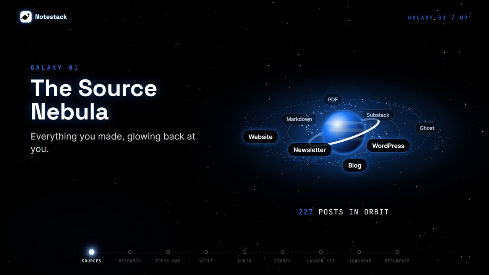

<p align="center">
  <picture>
    <source media="(prefers-color-scheme: dark)" srcset="marketing/logo/notestack-logo.svg">
    
  </picture>
</p>

<h3 align="center">The NotebookLM alternative for writers, bloggers and newsletters.</h3>

<p align="center">
  Your knowledge, in orbit. <a href="https://notestack.ai">notestack.ai</a>
  · <a href="https://notestack.ai/notebooklm-alternative">Notestack vs NotebookLM</a>
  · <a href="https://notestack.ai/blogs">Blog</a>
</p>

<p align="center">
  <a href="marketing/notestack-launch.mp4">
    
  </a>
  <br>
  <sub>▶ Watch the launch trailer (82 s, sound on) · <a href="https://notestack.ai/demo.mp4">product demo (47 s)</a></sub>
</p>

Notestack turns any blog, newsletter, website or folder of markdown into a grounded research notebook, then into audio
overviews, videos and launch kits, all traced back to the exact lines you actually wrote.

## Who it is for

Writers who publish regularly and have an archive they are not getting full value from:

- **Newsletter writers** with hundreds of past issues and no easy way to find or reuse them.
- **Bloggers** who want old posts to keep working instead of sitting forgotten.
- **Creators** who need to turn writing into audio, video and social posts without starting from scratch each time.

## What you get

- **Your whole archive in one place.** Connect a blog, newsletter or site once and new posts arrive on their own.
- **Answers you can trust.** Ask your archive anything and get replies that cite the exact lines behind them. If it is not in your writing, Notestack says so.
- **Audio and video from your words.** Two-host audio overviews, vertical shorts, explainers, audiograms and quote cards.
- **Launch Kits.** Hooks, threads, LinkedIn posts, Substack Notes, Bluesky posts, SEO packs and carousels, all editable.
- **Scheduled posting.** Plan a calendar and post to X, LinkedIn and Bluesky, with reminders and engagement tracking.
- **Your voice, every time.** Notestack learns how you write and uses that voice in every draft.
- **See what you have written about.** A topic map shows what you cover, what is rising and what has gone quiet.
- **Old posts, new life.** Resurfacing finds your evergreen pieces and suggests fresh angles to reshare them.

## Why Notestack instead of NotebookLM

NotebookLM is a great general research notebook. Notestack is built for people who publish: it starts from your whole
archive, stays in sync with it, cites the exact lines behind every answer, and turns what you wrote into things you can ship.

| | Notestack | NotebookLM |
| --- | --- | --- |
| Getting your writing in | Syncs any blog, newsletter or site (Substack, Ghost, WordPress, Medium, RSS), plus md, txt, html and pdf uploads | Add sources one at a time |
| Stays in sync | New posts arrive automatically | Re-add sources by hand |
| Citations | Exact line ranges, verified before you see them | Passage level citations |
| Not in your sources | Says so; unverifiable claims are dropped | Grounded, passage citations |
| Audio | Two hosts, or your consented voice clone | Two host overviews |
| Video | 9:16 shorts, 16:9 explainers, 1:1 audiograms, quote cards | Video overviews |
| Publishing | Launch Kits (threads, LinkedIn, Notes, Bluesky, SEO, carousels) and auto posting | Not a publishing tool |
| Your voice | Voice profile learned from your posts, used in every draft | General purpose writing |
| Seeing your archive | Topic constellation with rising and dormant topics, evergreen resurfacing | Idea Constellations per notebook |

The full comparison lives at [notestack.ai/notebooklm-alternative](https://notestack.ai/notebooklm-alternative).

## How it works

1. **Connect** your blog, newsletter or site, or upload files.
2. **Ask** questions and get cited answers from your own writing.
3. **Create** audio, video and launch kits from any post or topic.
4. **Publish** on a schedule and watch what lands.

## Plans

Notestack has three plans. The free plan indexes your first 5 posts, and paid plans index the rest of your archive.

## Brand

- Palette: black, blue (`#217cff`) and white.
- Logo files for dark and light backgrounds are in `marketing/logo/`.
- Launch trailer: `marketing/notestack-launch.mp4`, poster: `marketing/notestack-launch-poster.jpg`.
- Product demo: [notestack.ai/demo.mp4](https://notestack.ai/demo.mp4).
- Voice: plain and direct, and no em dashes in any copy.

## Links

- Site: [notestack.ai](https://notestack.ai)
- Comparison: [Notestack vs NotebookLM](https://notestack.ai/notebooklm-alternative)
- Blog: [notestack.ai/blogs](https://notestack.ai/blogs)

---

## Hugging Face Space config

```yaml
title: NoteStack Test
emoji: 📚
colorFrom: indigo
colorTo: purple
sdk: docker
app_port: 7860
pinned: false
```
